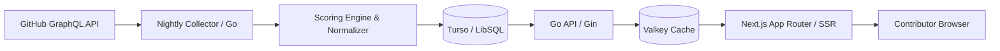

<div align="center">

# GetMerged

### Find GitHub repos that actually merge your PRs.

Open-source projects ranked by **review speed**, **outside-PR merge rate**, and **first-timer success**, so you stop sending pull requests into ghost towns.

[**Live site**](https://getmerged.abhishekco.de?utm_source=github&utm_medium=readme&utm_campaign=hero) · [Good first issues](https://getmerged.abhishekco.de/good-first-issue?utm_source=github&utm_medium=readme) · [How scoring works](https://getmerged.abhishekco.de/how-c-rank-works?utm_source=github&utm_medium=readme) · [Browser extension](extension/)

[](LICENSE)
[](https://github.com/abhisheksoni27/getmerged/actions)
[](https://getmerged.abhishekco.de)
[](https://github.com/abhisheksoni27/getmerged/stargazers)

<!-- Hero screenshot or demo GIF -->


</div>

---

## Why this exists

Most "good first issue" lists tell you where issues are. They don't tell you whether anyone will review your PR. A repo with 40k stars can have a median review wait of months, and a 1.8k-star repo can review in hours.

GetMerged scores repos on what maintainers actually do, using public GitHub activity, so you can pick projects where your PR has a real chance of getting merged.

**Who it's for**
- **First-timers and students** building a portfolio with merged PRs
- **Job-seekers** who want contribution proof that recruiters can verify
- **Developers giving back** to the tools they already use (see Stack Scanner)
- **Maintainers** who want to show contributors that their project reviews fast

## What you get

| Feature | What it does |
|---|---|
| **C-Rank score (S to D)** | Per-repo grade from outside-PR merge rate, review response time, recent activity, and first-timer acceptance |
| **Repo scorecards** | 90-day trend, PR-size vs. review-speed analysis, best time to submit, active maintainer count |
| **Good first issues** | Fresh issues from welcoming repos only, by language, with PR-in-progress flags |
| **Stack Scanner** | Paste your dependencies, get beginner issues in the tools you already use |
| **Compare** | Put two repos side by side before you commit to one |
| **README badge** | Maintainers embed a live C-Rank badge (see below) |
| **Browser extension** | Shows the score right inside GitHub repos (unpacked via `extension/`, Web Store listing in progress) |
| **PR preflight Action** | Forecasts merge odds on your PR in CI (see below) |
| **Weekly digest / alerts** | Fresh issues for your language, no account needed |

## How the score works

C-Rank is computed from public GitHub data via the GraphQL API and recalculated daily. Bot and org-member PRs are excluded so the numbers reflect what an outside contributor experiences.

| Signal | What it measures | Weight |
|---|---|---|
| **External PR merge rate** | Share of non-core PRs that get merged | 22.5% |
| **Maintainer breadth** | Reviews spread across multiple active maintainers (not a solo bottleneck) | 15.0% |
| **Review response time** | Median hours until a maintainer first replies | 12.5% |
| **Activity recency** | How recently code, issues, or reviews actually moved | 12.5% |
| **Time to merge** | Median days from PR submission to final merge | 10.0% |
| **First-timer success** | Share of first-time contributors whose PRs are merged | 10.0% |
| **Repeat contributor rate** | Share of outside contributors who come back for PR #2 | 10.0% |
| **Review rounds** | How many back-and-forth review cycles before a verdict | 5.0% |
| **Issue responsiveness** | Speed and consistency of triage on new issues | 2.5% |

Grades:
- **S (Elite)**: 70–100 (Multi-maintainer teams with rapid turnaround and high acceptance)
- **A (Responsive)**: 55–69 (Solid review turnaround and consistent merge velocity)
- **B (Average)**: 40–54 (Active, but reviews may take days or backlog is growing)
- **C / D (Slow / Stale)**: Below 40, or repos inactive for 90+ days (automatically capped at Tier D)

**Known limits** (we'd rather tell you than have you find out):
- **Small samples are noisy**: Repos with fewer than 10 scored PRs are labeled with a low-sample warning, pulled toward a neutral 50-score baseline via Bayesian weighting, and capped at Tier B so 1 lucky merge can't fake an S-tier.
- **Merge rate can reward trivial PRs**: A repo merging 100 single-character typo fixes can look great on paper. We weigh maintainer breadth (15%) and review rounds (5%) so rubber-stamp projects don't crowd out repos doing real, substantive reviews.
- **Single-maintainer bottleneck (Bus Factor)**: If a single maintainer does 100% of the reviewing, the repo is capped at Tier A even if its raw score is 90+. Tier S is strictly reserved for projects where reviews continue when one person goes offline.

Full methodology: [getmerged.abhishekco.de/how-c-rank-works](https://getmerged.abhishekco.de/how-c-rank-works)

## Add the badge to your repo

```markdown
[](https://getmerged.abhishekco.de/OWNER/REPO?utm_source=github&utm_medium=badge)
```

Example live badges:
[](https://getmerged.abhishekco.de)
[](https://getmerged.abhishekco.de)
[](https://getmerged.abhishekco.de)

## Architecture



| Layer | Stack |
|---|---|
| Backend | Go 1.22+, Gin |
| Database | Turso (LibSQL) in prod, SQLite locally. Plain SQL, no ORM |
| Cache | Valkey, plus `Cache-Control` for edge caching |
| Data source | GitHub GraphQL API |
| Frontend | Next.js 15 (App Router), React 19, Tailwind CSS v4 |
| Rendering | Server Components (SSR) for SEO and zero layout shift |
| Auth | GitHub OAuth, signed JWT sessions |

### Engineering decisions

- **Why plain SQL, no ORM:** Simple, readable queries with zero ORM overhead. It keeps query execution obvious, avoids accidental N+1 joins during batch ingestion, and makes migrations between local SQLite and production LibSQL seamless.
- **Scoring at scale (102,000+ repos):** The collector runs nightly background batches against GitHub's GraphQL API. It groups repo lookups into chunked queries, respects secondary rate limits via backoff, and writes snapshots incrementally without locking the database.
- **Percentile normalization:** Raw numbers lie. A 5-day review wait in a massive compiler repo like LLVM is blazing fast, but in a small 500-star utility it's sluggish. Metrics are normalized against peer repos in similar tiers and languages so projects are evaluated fairly.
- **Caching strategy:** Popular scorecards and ranking lists are cached in Valkey and served with `Cache-Control: public, s-maxage=604800, stale-while-revalidate=1209600`. Responses hit edge caches in under 50ms, with zero backend load on repeat traffic.
- **SEO & SSR:** Every repo scorecard (`/[owner]/[name]`), ranking list (`/rankings/[lang]`), and beginner issue page (`/good-first-issue`) is rendered server-side in Next.js. Search crawlers get instant, complete HTML with structured JSON-LD schemas—no empty loading spinners, no client-side waterfalls.
- **Biggest trade-off / thing I'd change:** Relying solely on scheduled GraphQL queries means scores update on a daily cadence rather than real-time. If starting over, I'd incorporate GitHub webhook events earlier to capture live PR events as they happen.

## Project structure

```
getmerged/
├── backend/
│   ├── cmd/
│   │   ├── server/               # API entrypoint
│   │   └── recalculate_history/  # Re-score historical snapshots
│   └── internal/
│       ├── analytics/            # Aggregate stats
│       ├── auth/                 # JWT + GitHub OAuth
│       ├── scoring/              # C-Rank math + percentile normalizer
│       ├── pipeline/             # GraphQL collector + scoring pipeline
│       └── handler/              # Gin HTTP handlers
├── frontend/                     # Next.js app (SSR pages, SEO)
├── extension/                    # Browser extension (Chrome Manifest V3)
├── pr-readiness-action/          # PR preflight GitHub Action
└── docs/                         # Migrations and schemas
```

## Run it locally

**Backend**
```bash
cd backend
cp .env.example .env   # GITHUB_TOKEN, DATABASE_URL, VALKEY_URL, JWT_SECRET
go run ./cmd/server
```

**Frontend**
```bash
cd frontend
cp .env.example .env.local
npm install
npm run dev
```

**Quickstart without GitHub API keys:**
You can boot the full stack locally with sample data without touching GitHub tokens:
```bash
# Backend boots with local SQLite by default
cd backend && go run ./cmd/server

# In another terminal, start the frontend
cd frontend && npm run dev
```
Visit `http://localhost:3000` to see the local workbench.

**Running tests:**
```bash
# Run all frontend and backend checks at once
make check

# Or test backend / frontend separately
cd backend && go test -v ./...
cd frontend && npm test
```

## Roadmap

- [ ] Org-level dashboards: aggregate PR acceptance and review turnaround across every repo in an organization.
- [ ] GitHub Marketplace listing for the Preflight Action (`opendoor/preflight`).
- [ ] Weekly personalized email digest: fresh, unassigned beginner issues matched to your stack.
- [ ] Embeddable contributor karma cards for personal dev portfolios.

## Contributing

This project eats its own cooking: open good first issues are labeled [here](https://github.com/abhisheksoni27/getmerged/issues?q=is%3Aissue+is%3Aopen+label%3A%22good+first+issue%22).

We promise:
1. Every outside PR gets reviewed within 24 hours.
2. Clear, constructive feedback—no ghosting, no gatekeeping.
3. If your PR passes checks and matches the issue scope, it gets merged.

Read [CONTRIBUTING.md](CONTRIBUTING.md) for local dev setup, test guidelines, and PR conventions.

## FAQ

**How is this different from other good-first-issue lists?**
Those list issues. GetMerged scores whether maintainers actually review and merge outside PRs.

**Is my repo scored without my permission?**
Scores use only public GitHub data. Maintainers can claim their repository page using GitHub OAuth to pin submission guidelines, showcase active reviewers, or trigger an instant on-demand score re-sync.

**How often is data refreshed?**
Scores recalculate every 24 hours. Good first issues are synced on a rolling background loop, and issues closed or assigned on GitHub are automatically removed within 15 minutes.

## License

Distributed under the [MIT License](LICENSE). The backend, frontend, scoring engine, and telemetry calculations are 100% open source.

## Author

Built by [Abhishek Soni](https://github.com/abhisheksoni27) · [X / Twitter (@abhisheksoni27)](https://x.com/abhisheksoni27) · [Website](https://abhishekco.de)

If GetMerged helped you land a PR, a star helps others find it.
